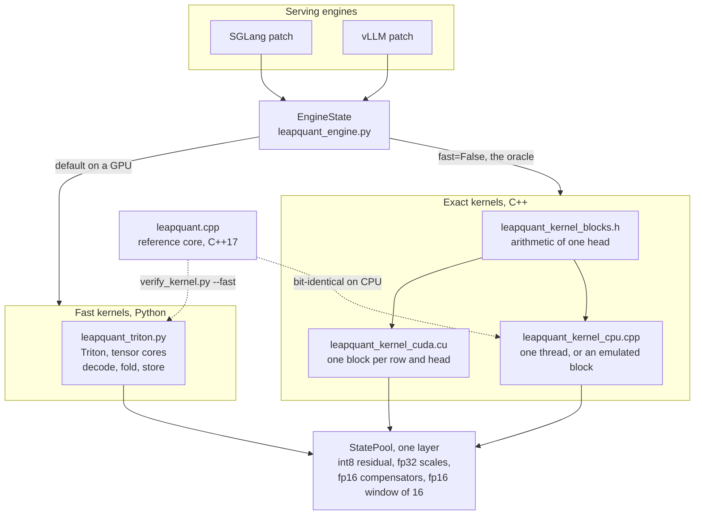
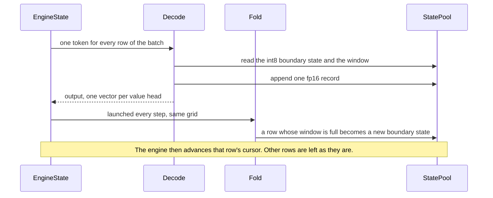

# LeapQuant

An implementation of LeapQuant (arXiv 2609.38166) for serving engines: the recurrent state of
linear-attention layers is stored in 8 bits and rewritten once every 16 tokens, instead of being
read and written in fp32 for every token.

This repository is FastPathLabs' implementation of the method, written from the paper. The method is
the work of Pan et al. ([arXiv 2609.38166](https://arxiv.org/abs/2609.38166),
[leapquant.github.io](https://leapquant.github.io)). The code, the kernels, the serving integration and
the measurements here are ours, except the parts listed in [NOTICE](NOTICE): the Triton decode kernel
adapts the structure of an SGLang kernel (Apache-2.0), and the LiveCodeBench grader copies LiveCodeBench
code (MIT). A write-up of the results is on our blog:
[first serving results](https://fastpathlabs.ai/blog/3x-faster-linear-attention-kernels) and
[how the implementation works](https://fastpathlabs.ai/blog/leapquant-architecture).

**Status: research code.** It is not a supported product. All numbers come from one H100 PCIe 80 GB.
Most serving numbers are one run per arm. The paper measured on B200, so its numbers and ours are not a
like-for-like comparison. The raw results of the runs are in `results/`, and charts and tables per run
are in `reports/all_reports.html`.

### Main numbers, and where each one comes from

| What | Result | Source |
|---|---|---|
| Gate G3: one layer at batch 512, ms per token (decode + 1/16 of a fold), against SGLang's bf16 window kernel | 0.300 against 0.382 ms: 1.27x (10 paired runs, 95% interval 1.270-1.272) | `results/g3-final/G3.txt` |
| Same layer, against SGLang's packed fp32 kernel | 1.198 ms for SGLang (the paper reports 2.52x against fp32 on B200) | `results/g3-final/v9_*.txt` |
| State memory per request (24 layers) | 21.3 MB instead of 50.3 MB in fp32 | (19,456 + 8,224 bytes) x 32 heads x 24 layers, against 128 x 128 x 4 bytes x 32 x 24; see "The kernel in one page" below |
| KV tokens the server can hold (same GPU memory budget) | 993,215 against 495,468 for fp32 state (2.0x) and 926,316 for bf16 window | `results/run-quick-einstein-v6/server_config*_memory.txt` |
| Median time between tokens, 512 users, short prompts (older build, round 6) | 42.3 ms against 61.6 ms for fp32 packed and 48.8 ms for bf16 window; output throughput 6,283 tok/s against 6,830 for bf16 window | `results/run-quick-einstein-v6/serving_config*_short_c512.log` |
| Decode-heavy cell (128 in / 512 out), 512 users, final build | 1.45x fp32 state and 1.04x bf16 window, one run per arm per session | `results/round12`, `results/round12b` |
| Later paired validation runs, final build, other cells | output throughput 0.976x bf16 window (128 in / 512 out, 64 users), 0.982x (InferenceX 1k/1k, 16 users), 0.986x (AA-SLT 1k/1k, 16 users) | `results/harness/validation_pair/b1/*/*/metrics.json` |
| 1,024 users | 1.53x fp32 (two sessions) | `results/round13`, `results/round13b` |

Read the bf16 window rows together: against SGLang's bf16 window kernel, LeapQuant is clearly faster per
kernel call, but end to end it is level, slightly ahead in some sessions and slightly behind in others.

Answer budgets differ between accuracy runs: `results/accuracy-paper` uses the paper's 81,920 tokens, but
the quality runs in `results/harness/quality-12h-r2` use 131,072 (`max_tokens` in each file). The fold
policy depends on the patch level: the base SGLang patch folds all rows together when `LEAPQUANT_FOLD_POLICY`
is unset, and `integrations/sglang/apply_fold_policy_default_stagger.py` changes that default to `stagger`.

## Architecture

Two kernels share one state pool. The C++ kernel is the oracle. The server runs the Triton kernels.

| Piece | Language | Role |
|---|---|---|
| `leapquant.cpp` | C++17 | Reference core. One head, the numbers the rest must match. |
| `kernel/leapquant_kernel_blocks.h` plus `leapquant_kernel_cuda.cu` and `leapquant_kernel_cpu.cpp` | C++ / CUDA | Exact kernel. One thread block per request and value head. Bit-identical to the reference on the CPU. |
| `kernel/leapquant_triton.py` | Python, Triton | Fast kernel. Tensor cores. What SGLang and vLLM run when Triton imports. |
| `kernel/leapquant_engine.py` | Python | `EngineState`: one decode and one fold per layer. `fast=None` picks Triton on a GPU, otherwise the exact kernel. |



One decode step of one layer, for either kernel:



## What is here

| Path | What it is |
|---|---|
| `leapquant.h`, `leapquant.cpp` | The reference core. Plain C++17, one attention head at a time. It defines the correct numbers. Read `leapquant.h` first. |
| `reference_heads.*`, `leapquant_test.cpp` | The fp32 ground truth, the naive baselines, and the tests of the reference core. |
| `record_trace.py`, `leapquant_replay.cpp` | Record what a Qwen3.5 model feeds its kernel; replay it on a CPU through every storage method. |
| `kernel/leapquant_kernel.h` | The batched kernel: a state pool for all requests, a decode step and a fold for a whole batch. |
| `kernel/leapquant_kernel_blocks.h` | The kernel's arithmetic, written once as the work of one GPU thread block. |
| `kernel/leapquant_kernel_cuda.cu` | Launches the blocks on a GPU. |
| `kernel/leapquant_kernel_cpu.cpp` | Runs the same blocks on a CPU, in one thread or as an emulated thread block. |
| `kernel/leapquant_kernel.py` | Python bindings: `StatePool`, `Kernel`. |
| `kernel/leapquant_triton.py` | The fast kernels: decode step, fold and store in Triton, on the same `StatePool`. Checked by `kernel/bench_triton.py` and `kernel/verify_kernel.py --fast`. |
| `kernel/leapquant_engine.py` | What a serving engine calls per layer and per decode step: `EngineState`. |
| `kernel/verify_kernel.py` | Compares the kernel (CPU or GPU) with the reference core on a trace. |
| `kernel/profile_kernel.py` | Where the kernel's time goes, phase by phase, with aligned and staggered folds. |
| `kernel/fit_quality.py` | How much of the best possible the compensator fit captures, on real states. |
| `kernel/gates_test.py` | Tests of the verification gates themselves. |
| `reports/generate_reports.py` | HTML reports with charts, one new folder per run and time. |
| `kernel/bench_kernel.py`, `kernel/tune_kernel.py` | Time the kernel next to SGLang's kernels; try its build options and keep the fastest correct build. |
| `eval/accuracy_bench.py` | Answer accuracy against a running server: GSM8K, AIME 2025, MMLU-Pro. |
| `run_on_cuda.sh` | Runs everything on the GPU machine. |
| `kernel/kernel_test.cpp`, `kernel/engine_test.py`, `kernel/block_engine_test.py` | Tests of the kernel and of the engine glue for SGLang and for vLLM (`--fast` for the fast kernels). |
| `kernel/compressed_test.py`, `kernel/summarize_verify.py` | The compressed-state mode of the engine glue; the verdict over a set of traces for the fast kernels. |
| `integrations/sglang/` | The SGLang patch and a smoke test. The patch loads the kernels from this repository (`LEAPQUANT_HOME`), so it is a research integration, not a patch for upstream. |
| `integrations/vllm/` | The vLLM patch (first port: prefix caching off). **Untested: it byte-compiles but has never run in vLLM.** See `docs/VLLM_PORT.md`. |
| `runbook/` | One script per stage of the plan's H100 test; `fast_checks.sh`, `serving_fast.sh` and `accuracy_fast.sh` for the fast kernels (all restartable, meant to run detached). |
| `results/` | Where measurements are recorded. |

## Requirements and setup

- **No GPU:** a C++17 compiler, plus Python 3 with `torch` and `numpy` for the Python checks.
- **GPU:** one NVIDIA H100 (the measured card is an H100 PCIe 80 GB), CUDA 12.8 or newer, Linux.
- **Docker:** only for the LiveCodeBench grader, which runs model-written code in a container with no network.

**Read the setup scripts before you run them.** `runbook/stage_a_setup.sh` and `runbook/stage_b_baselines.sh`
are written for a disposable rented GPU machine. They pipe the uv and rustup installers from the web into `sh`,
install system packages with `sudo apt-get`, install SGLang and vLLM with pip (the vLLM install is not pinned to a version; the SGLang venv is pinned in `runbook/locks/`), and put virtual environments and
checkouts in `$HOME`. Do not run them on a machine you care about.

**About the run records.** The files in `results/` and `reports/` are kept as they were written during the runs.
They include the team's working notes, such as who made a decision, and an assumed host price of $2.00 per hour.
Two quoted chat lines were removed from them before release; nothing else in them was edited, apart from the
GPQA answer texts (see `results/harness/quality-12h-r2`).
That price is a scenario value, not an invoice.

## Check everything that needs no GPU

Needs a C++17 compiler and, for the last step, Python with `torch` and `numpy`.

```
make check
```

It runs the reference tests, the recorder self-test, the kernel against the reference, the
kernel under two sanitizer builds, and the Python tools. It takes about a minute. Every part
prints `0 failed` or `PASS`.

## On the GPU machine

```
./run_on_cuda.sh            # every step in order; start it again after a fix
./run_on_cuda.sh --list     # the steps and their state
./run_on_cuda.sh --only d   # one step
```

It sets up the environments, builds and checks the GPU kernel, tunes its build options, runs
the baselines, records and replays traces, patches SGLang and runs the serving, accuracy and
prefix-cache measurements. Each step can also be run by hand from `runbook/`.

Stages B and C are the two gates of the plan. They run existing engine code and the CPU
replay, so they tell you whether the rest is worth doing before any new GPU code is trusted.

### The fast serving path (the configuration measured on 14 Nov 2026)

```
make fast-fold                          # build/libleapquant_fastfold.so: CUDA fold, store and decode
export LEAPQUANT_STATE=compressed       # the compressed state is the only state
export LEAPQUANT_FOLD_BACKEND=cuda      # CUDA fold (batched Gram-Schmidt) and CUDA store
export LEAPQUANT_DECODE_BACKEND=cuda    # CUDA decode; LEAPQUANT_CUDA_DECODE_VARIANT=9 is the default
# LEAPQUANT_STEP_REUSE=1 (default): the decode inputs are built once per step, not once per layer.
# LEAPQUANT_FUSED_SLOT_COPY=1 (default): the radix cache's per-request slot copy in one launch.
# Radix cache on: LEAPQUANT_FOLD_POLICY=auto (each request folds on its own step). Latency-bound
# serving: LEAPQUANT_FOLD_POLICY=stagger (p99 between tokens at bf16 window's level, 1-2% throughput).
```

With these, gate G3 is met (1.27× SGLang's bf16 window kernel per token at batch 512, 10 paired
runs, `results/g3-final`), and the decode-heavy cell (128 in / 512 out, 512 users) serves 1.45×
SGLang's default fp32 state and 1.04× bf16 window (`results/round12`, `round12b`; later paired runs on
other cells measured 0.976-0.986×, see the table at the top). At 1,024 users
it serves 1.53× fp32 (two sessions, `results/round13`, `round13b`). With the radix cache on, at
equal state memory, it is 0.97-1.03× bf16 window (`results/ab-slotcopy`). Without `make fast-fold`
or with a pool outside the CUDA kernels' limits, the Triton kernels run.

## The kernel in one page

A state pool holds, per request slot and attention head, the boundary state (int8 matrix, two
scale vectors, 4 compensators: 19,456 bytes) and the window buffer (16 fp16 records: 8,224
bytes). The number of records in a request's window is a cursor that the engine owns.

```python
pool   = StatePool(slots, value_heads=32, device="cuda")
kernel = Kernel(pool.device)

kernel.store(pool, slot, prefill_state)                 # after prefill
# every decode step, every layer:
kernel.decode_step(pool, slot, cursor, decay, beta, key, query, value, out)
kernel.fold(pool, slot, cursor, tokens_added=1, force=force)
# once per decode step:
cursor = next_tokens_in_window(cursor, pool.window_length, force)
```

`decode_step` only reads the int8 matrix and appends one record. `fold` is launched after
every step and decides on the device which rows fold, so the launches are the same every step.

The kernel source is correct on any number of threads per block, and every sum in it is
added up by one thread in a fixed order. Built without fused multiply-add, the CPU build
reproduces the reference core bit for bit over whole traces. The GPU build is the same
source; a GPU can differ in the last bit of `exp` and `log`. See `kernel/verify_kernel.py`
for how the GPU build is judged.

## License

Apache License 2.0. See [LICENSE](LICENSE) and [NOTICE](NOTICE). The LeapQuant method is the work of Pan et al. (arXiv 2609.38166). This implementation is ours, except the parts listed in NOTICE.

## Citation

If you use this code, please cite the LeapQuant paper (Pan et al., arXiv 2609.38166). [CITATION.cff](CITATION.cff) has the entry for this repository.
